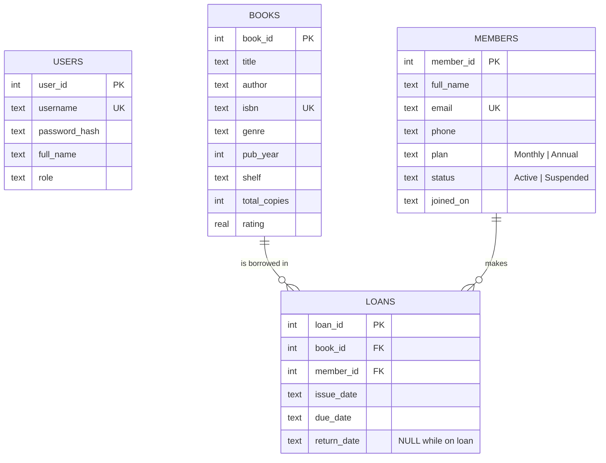

# Bibliotheca — ER Diagram

(Paste the block into https://mermaid.live to export it as an image for your report.)

## Design notes

- **3NF.** Every non-key column depends only on its table's key. Member and book details are stored once and referenced from `loans` by foreign key.
- **No redundant data.** `available copies` and loan `status` (Issued / Overdue / Returned) are *derived* in the views `v_books` and `v_loans`, so they can never drift out of sync with the loans table.
- **Relationships.** One book → many loans; one member → many loans (both 1:N). `loans` is the associating table that resolves the M:N relationship between books and members over time.
- **Referential integrity.** `ON DELETE RESTRICT` — a book or member with circulation history cannot be deleted.
- **Business rules in the database (triggers):** active members only, copy must be available, max 5 open loans per member, no duplicate open loan of the same title, total copies can't drop below copies on loan.
- **Domain integrity (CHECK):** plan and status enumerations, year range, copies ≥ 1, `due_date ≥ issue_date`, `return_date ≥ issue_date`.
- **Security.** Passwords are stored as bcrypt hashes, not plain text.
